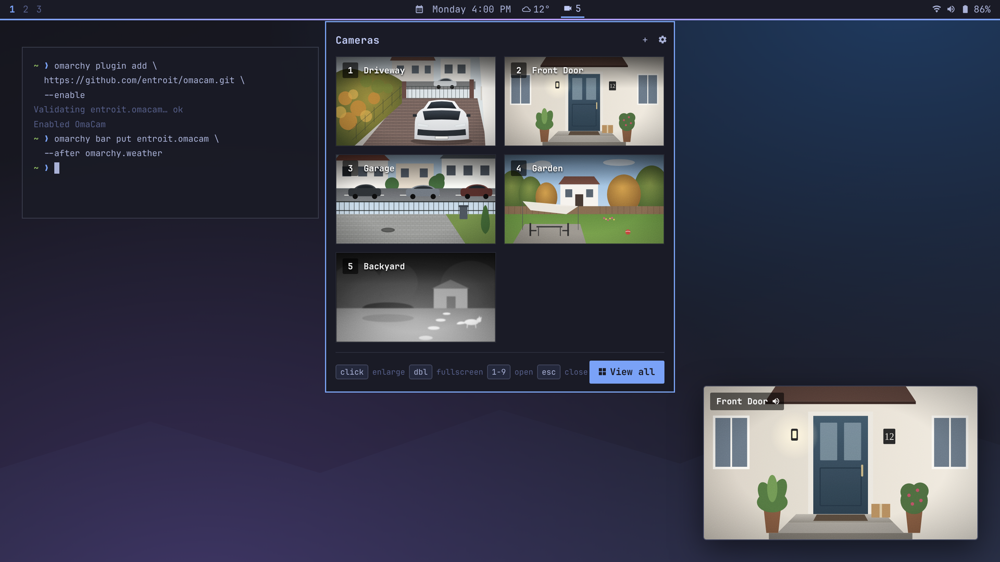
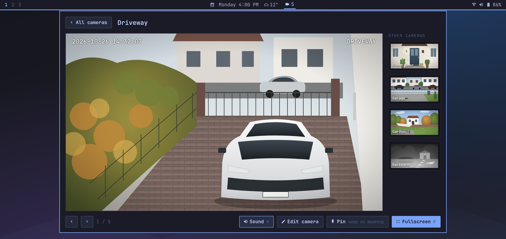
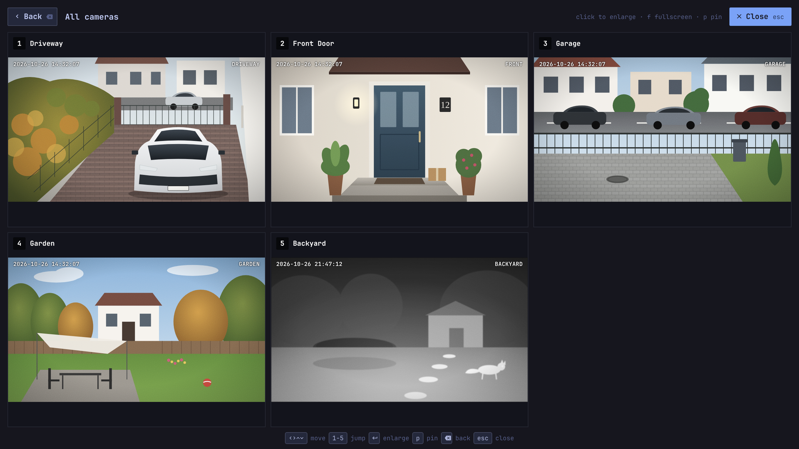
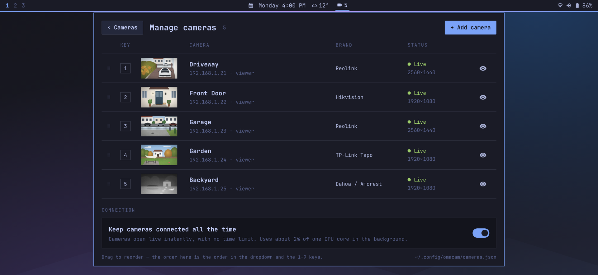

<p align="center">
  
</p>

<h1 align="center">OmaCam</h1>

<p align="center">
  <b>Your IP cameras, one click away in the Omarchy bar.</b><br>
  Live grid, enlarged view, fullscreen, camera wall and pinned floating players.
</p>

<p align="center">
  <a href="#install">Install</a> ·
  <a href="#features">Features</a> ·
  <a href="#using-it">Using it</a> ·
  <a href="#configuration">Configuration</a> ·
  <a href="#privacy-and-security">Privacy</a> ·
  <a href="#troubleshooting">Troubleshooting</a>
</p>

<p align="center">
  
  
  
  
</p>

<p align="center">
  
</p>

<p align="center"><sub>Screenshots are mockups with drawn scenes and made-up addresses.</sub></p>

## Features

- **Bar widget.** A camera icon next to the weather, with how many cameras are online.
- **Dropdown grid.** Every camera live; press `1`–`9` to jump straight to one.
- **Enlarged view.** One camera big, the others in a side rail, sound on demand.
- **Fullscreen and camera wall.** A single camera or all of them across the screen.
- **Pinned players.** Keep a camera floating on the desktop; drag it, snap it to an edge, resize it from any corner.
- **No reconnecting.** Each camera is connected once and every view shares that stream, so moving between views is instant.
- **Quick first picture.** A still image appears in well under a second while the live video starts.
- **Most brands built in.** Hikvision, Dahua / Amcrest, Reolink, TP-Link Tapo, D-Link, EZVIZ, Axis, Uniview, Foscam, or any `rtsp://` / `http://` address.
- **Fully configurable.** Every key, click, timing and layout option lives in one JSON file that reloads live.
- **Follows your theme.** Colours come from the active Omarchy theme and switch with it.

<table>
  <tr>
    <td width="50%"></td>
    <td width="50%"></td>
  </tr>
  <tr>
    <td align="center"><sub>Enlarged view</sub></td>
    <td align="center"><sub>Camera wall</sub></td>
  </tr>
</table>

## Install

```bash
omarchy plugin add https://github.com/entroit/omacam.git --enable
omarchy bar put entroit.omacam --after omarchy.weather
```

Nothing else to install: OmaCam uses Qt Multimedia's FFmpeg backend
(`qt6-multimedia-ffmpeg`), `ffmpeg`, `curl` and `python`, which all come
with Omarchy.

### Remove

```bash
omarchy plugin remove entroit.omacam
rm -rf ~/.config/omacam        # optional: saved cameras, passwords and settings
```

## Adding a camera

Click the bar icon, then **+** (or **Add your first camera**). Enter a name,
the brand, the IP address, username and password, then press **Test
connection**. The brand fills in the stream address, and the test tries that
brand's known addresses until one answers. For anything not in the list, pick
**Other / Custom URL** and paste the full `rtsp://` or `http://` address.

To support another brand, add one line to [`Brands.js`](Brands.js).

<p align="center">
  
</p>

## Using it

| Where | Action |
|---|---|
| Bar icon | left click: dropdown · right click: manage cameras · middle click: camera wall |
| Dropdown | click: enlarge · double click: fullscreen · `1`–`9` (or the numpad) open the numbered camera · `f` fullscreen · `a` wall · `n` new · `m` manage · `esc` close |
| Enlarged | `←` `→` switch · `m` sound · `e` edit · `p` pin · `f` fullscreen |
| Fullscreen | `1`–`9` jump · `←` `→` switch · `h` hide strip · `m` sound · `p` pin · `a` wall · `⌫` back · `esc` close |
| Camera wall | arrows or `hjkl` move · `↵` open · `p` pin · `⌫` back · `esc` close |
| Pinned player | drag to move (snaps to edges) · any corner resizes · double click: fullscreen |

These are the defaults; every key and click can be changed in the
[config file](#configuration).

**Sound** plays only in the enlarged view, fullscreen and pinned players, and
only for one camera at a time: the view opened or pinned last gets it. Press
`m` or the speaker button to mute; after 20 s muted the audio stream closes.
Cameras that announce audio but never send any (microphone off) show
"No sound".

### Keybinding and IPC

```
bind = SUPER, C, exec, omarchy-shell omacam toggle
```

Other calls: `open`, `close`, `wall`, `manage`, `add`, `edit <n|name>`,
`camera <n|name>`, `fullscreen <n|name>`, `pin <n|name>`, `sound` (mute or
unmute whatever is playing).

## Configuration

Everything about how OmaCam behaves lives in one plain JSON file:
**`~/.config/omacam/config.json`**. It is created on first run with every
option and its default, and changes apply as soon as the file is saved, with
no restart. That makes it easy to edit by hand or to hand to an AI agent.

| Section | What it controls |
|---|---|
| `connection` | always connected, how long streams stay up after closing, retries, network checks, low latency |
| `sound` | when a muted audio stream disconnects |
| `bar` | the online count, and what left, middle and right click do |
| `dropdown` | columns, number badges, what click and double click on a tile do |
| `fullscreen` | crop to fill the screen, show the camera strip |
| `wall` | columns, crop to fill, what a click does |
| `pinned` | size of a new pinned player, edge-snapping distance |
| `keys` | every key, per screen: `dropdown`, `enlarged`, `fullscreen`, `wall` |

The two connection settings can also be changed under **Manage cameras →
Connection**; they are saved to the same file.

**Keys** are lists, so an action can have several keys, or none (`[]`). Use a
character (`"f"`, `"F"`, `"?"`) or a key name (`Escape`, `Return`, `Enter`,
`BackSpace`, `Tab`, `Space`, `Delete`, `Left`, `Right`, `Up`, `Down`, `Home`,
`End`, `PageUp`, `PageDown`, `F1`–`F12`), optionally with modifiers:
`"Ctrl+q"`, `"Shift+Tab"`, `"Alt+m"`, `"Super+w"`. On-screen hints follow
whatever you set. `keys.cameraNumbers` turns the `1`–`9` shortcuts on or off.

**Click actions** are `enlarge`, `fullscreen`, `pin` or `none` for tiles, and
`dropdown`, `wall`, `manage`, `fullscreen` (first camera) or `none` for the bar
icon.

Anything missing or of the wrong type falls back to its default. If the file
isn't valid JSON, OmaCam keeps the last good settings, leaves the file
untouched, and shows the error at the bottom of **Manage cameras**.

<details>
<summary><b>Full default <code>config.json</code></b></summary>

```json
{
  "version": 1,
  "connection": {
    "alwaysConnected": false,
    "keepConnectedSeconds": 180,
    "warmOnHoverSeconds": 15,
    "keepFullQualitySeconds": 30,
    "retrySeconds": 15,
    "statusCheckSeconds": 60,
    "lowLatency": true
  },
  "sound": {
    "closeAfterMutedSeconds": 20
  },
  "bar": {
    "showCount": true,
    "leftClick": "dropdown",
    "middleClick": "wall",
    "rightClick": "manage"
  },
  "dropdown": {
    "columns": 2,
    "showNumbers": true,
    "click": "enlarge",
    "doubleClick": "fullscreen"
  },
  "fullscreen": {
    "fill": false,
    "showStrip": true
  },
  "wall": {
    "columns": 0,
    "click": "fullscreen",
    "fill": false
  },
  "pinned": {
    "width": 360,
    "snapDistance": 28
  },
  "keys": {
    "cameraNumbers": true,
    "dropdown": {
      "up": ["Up", "k"],
      "down": ["Down", "j"],
      "left": ["Left", "h"],
      "right": ["Right", "l"],
      "open": ["Return", "Enter"],
      "fullscreen": ["f", "F"],
      "wall": ["a", "w"],
      "add": ["n"],
      "manage": ["m"],
      "nextPanel": ["Tab"],
      "previousPanel": ["Shift+Tab"],
      "close": ["Escape"]
    },
    "enlarged": {
      "previous": ["Left", "h"],
      "next": ["Right", "l"],
      "fullscreen": ["f", "F"],
      "sound": ["m"],
      "pin": ["p"],
      "edit": ["e"],
      "wall": ["a", "w"],
      "add": ["n"],
      "back": ["Escape"]
    },
    "fullscreen": {
      "previous": ["Left"],
      "next": ["Right", "l"],
      "toggleStrip": ["h"],
      "sound": ["m"],
      "pin": ["p"],
      "wall": ["a", "g"],
      "back": ["BackSpace", "f"],
      "close": ["Escape", "q"]
    },
    "wall": {
      "up": ["Up", "k"],
      "down": ["Down", "j"],
      "left": ["Left", "h"],
      "right": ["Right", "l"],
      "open": ["Return", "Enter", "f"],
      "pin": ["p"],
      "back": ["BackSpace"],
      "close": ["Escape", "q"]
    }
  }
}
```
</details>

> [!TIP]
> **For AI agents:** edit `~/.config/omacam/config.json` and keep it valid
> JSON; it reloads by itself. The camera list is a separate file,
> `~/.config/omacam/cameras.json`, which holds passwords: leave it alone
> unless the user asks for a camera change. The Hyprland binding that opens
> OmaCam lives in the user's Hyprland config (see above).

## How streams work

- Streams run only while something is on screen, plus a grace period after
  closing (3 minutes by default, `connection.keepConnectedSeconds`).
- The dropdown and wall use each camera's low-res stream. The enlarged view,
  fullscreen and pinned players add the full-quality stream; until it is live
  the low-res picture is shown, and it stays connected 30 s after you leave so
  switching back and forth is instant.
- Opening a view first shows a fresh still picture from each camera, fetched
  over HTTP and kept only in memory. The live video takes over once the camera
  sends its first full frame.
- When everything is closed, the widget checks once a minute which cameras
  answer on the network, and the bar shows `online/total`.

## Privacy and security

- Video goes straight from the camera to your machine. Nothing is sent
  anywhere else, and nothing is recorded or saved to disk.
- Cameras are stored in `~/.config/omacam/cameras.json`, readable only by
  you (mode 600), because it holds the camera passwords.
- Give OmaCam a **view-only camera account** rather than the admin login.
  Watching needs no more than that.

## Troubleshooting

<details>
<summary><b>A camera shows "Wrong password", "Offline" or "Wrong path"</b></summary>

OmaCam asks the camera why it refused and shows the reason on the tile, then
retries every 15 s. Check the details under **Manage cameras → edit**, and
press **Test connection** to try the brand's other stream addresses.
</details>

<details>
<summary><b>The picture visibly "snaps" every second or two</b></summary>

That is the camera's encoder: each full frame (I-frame) replaces the slightly
smeared frames before it. It shows most at low bitrates. In the camera's own
app or web page, raise the main stream's bitrate (for 4 MP cameras, 4096 kbps
or more) and set the I-frame interval to 2× the frame rate.
</details>

<details>
<summary><b>Live video takes a few seconds to start</b></summary>

Video can only start at a full frame, and cameras send one every 1–4 s. The
still picture covers the wait. To skip it entirely, turn on **Keep cameras
connected all the time**.
</details>

<details>
<summary><b>Changes to the QML don't show up</b></summary>

Run `omarchy-restart-shell`. Plugin hot reload keeps already-loaded files
cached.
</details>

## License

[MIT](LICENSE) © Entroit
